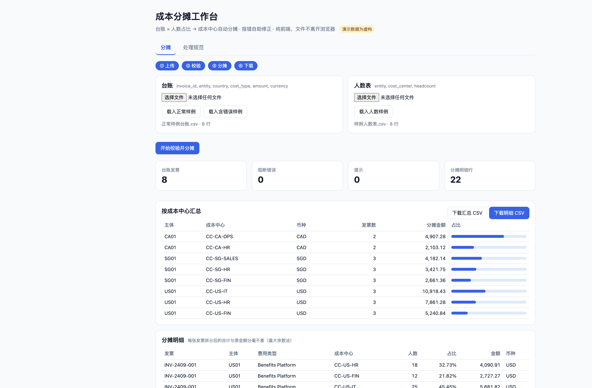
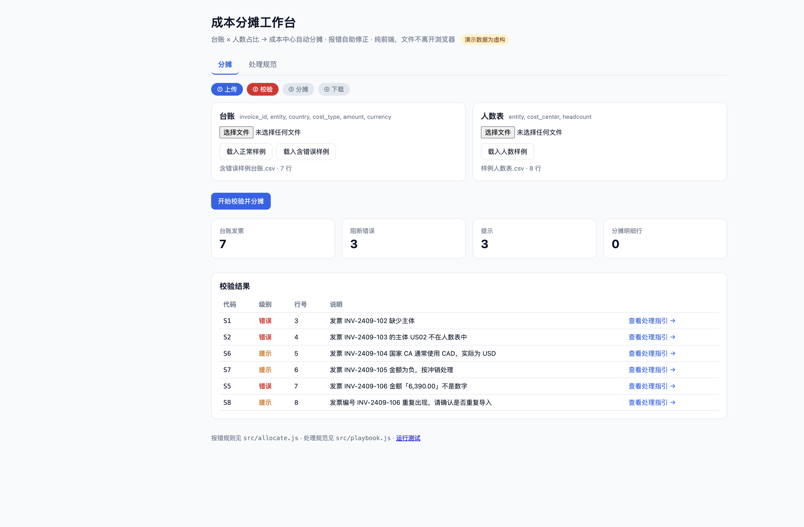

# Cost Allocation Workbench · 成本分摊工作台

**把「每月手工拆台账」变成上传两张表、一键分摊、报错自己会改的自助工具。**


> **Copyright © 2026 张文婧 (Anna Zhang)** · [MIT License](./LICENSE) · [github.com/annawzhang](https://github.com/annawzhang)  
> 欢迎学习与面试查阅；保留版权与许可声明。**禁止删除作者信息后冒充本人作品二次发表。** 公开内容为虚构/脱敏演示数据。


[在线演示](https://annawzhang.github.io/cost-allocation-workbench/) · [运行测试](https://annawzhang.github.io/cost-allocation-workbench/tests.html)

共享服务中心每月要把供应商发票（台账）按各法人主体下成本中心的人数占比拆分入账。
这个工作台把流程做成 **上传 → 校验 → 分摊 → 下载** 四步，纯前端运行，文件不离开浏览器。

> 演示数据中的主体、成本中心与金额均为虚构。



## 解决什么问题

| 痛点 | 做法 |
|---|---|
| 手工在 Excel 里按人数比例拆分，四舍五入后合计对不上原发票 | 最大余数法按「分」拆分，每张发票拆完的合计与原金额分毫不差 |
| 一出错就找开发或财务 BP，来回沟通 | 每条报错带编号，一键跳到处理规范，按 ①报错 ②检查 ③修改 ④上传 自行修正 |
| 主体写错、人数为 0、金额带千分位这类问题，到月结才发现 | 上传即校验，阻断类错误不出结果，提示类问题不阻断但会标出 |
| 规则散落在个人经验里 | 校验规则与处理规范一一对应，新增国家特例只需加一条规范 |

## 校验规则

| 代码 | 级别 | 规则 |
|---|---|---|
| E1 | 错误 | 缺少必需列 |
| S1 | 错误 | 台账行缺少主体 |
| S2 | 错误 | 主体不在人数表中 |
| S3 | 错误 | 主体人数合计为 0 |
| S4 | 错误 | 人数不是非负整数 |
| S5 | 错误 | 金额不是数字 |
| S6 | 提示 | 币种与国家常用币种不一致 |
| S7 | 提示 | 负数金额，按冲销处理 |
| S8 | 提示 | 发票编号重复 |



## 分摊口径

```text
某成本中心分摊额 = 发票金额 × 该成本中心人数 / 该主体人数合计
```

- 金额先换算为「分」，按人数权重取整，剩余的分按小数部分从大到小补齐（最大余数法）。
- 人数为 0 的成本中心不参与分摊；负数发票按同样比例冲销。

## 作为子应用嵌入

工作台可被父级工作台通过 iframe 嵌入，并用 `postMessage` 通信：

| 方向 | 消息 | 用途 |
|---|---|---|
| 子 → 父 | `workbench:ready` | 子应用加载完成 |
| 父 → 子 | `console:context` | 下发当前用户与角色，页面右上角显示来源 |
| 子 → 父 | `workbench:result` | 回传发票数、错误数、明细行数，父级可汇总到总览 |

配套的父级工作台见 [enterprise-ai-console](https://github.com/annawzhang/enterprise-ai-console)。

## 本地运行

无需构建，任意静态服务器即可：

```bash
python3 -m http.server 8000
# 打开 http://localhost:8000/ ，测试页为 /tests.html
```

## 代码结构

| 文件 | 作用 |
|---|---|
| `src/allocate.js` | 分摊核心：CSV 解析、校验、最大余数法拆分（纯函数） |
| `src/playbook.js` | 特殊情形处理规范，代码与校验规则一一对应 |
| `src/app.js` | 页面交互与 iframe 通信 |
| `tests.html` | 浏览器内单元测试（9 项） |

## 背景

本项目是作者在企业共享服务中心实习时所做分摊工具的公开复刻版，保留了产品设计，数据与规则细节均已替换。
